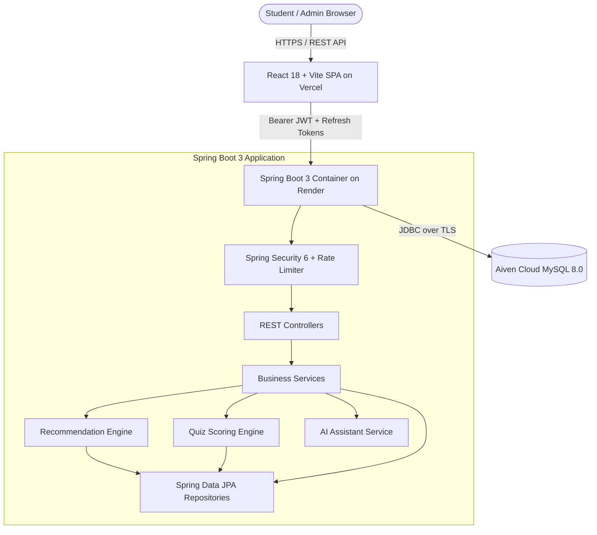

# EduPulse AI — AI-Powered Personalized Online Learning Portal

[](https://www.oracle.com/java/)
[](https://spring.io/projects/spring-boot)
[](https://react.dev/)
[](https://www.typescriptlang.org/)
[](https://vitejs.dev/)
[-blue.svg)](https://aiven.io/)
[](https://flywaydb.org/)
[](LICENSE)

An enterprise-grade, full-stack educational web application designed to deliver an adaptive, personalized learning journey. Built with a **Java 21 Spring Boot 3.3.4** backend, **Aiven Cloud MySQL** database, and a **React 18 + Vite + TypeScript** frontend styled with a tactile **Neumorphism** design system (`#E9EDF2`).

---

## 🚀 Key Highlights & Capabilities

* **Adaptive Recommendation Engine**: Rule-based scoring engine analyzing student interest keywords, category affinity, previous completion rates, and quiz weak spots, providing transparent, human-readable explanations (*"Recommended because you completed..."*).
* **Server-Side Evaluated Quizzes**: Answer keys and explanations are strictly withheld on the server until student submission, preventing client-side inspection vulnerabilities.
* **Context-Aware AI Learning Assistant**: Interactive tutor assisting students with conceptual breakdowns, practice questions, and structured roadmaps (operates in zero-cost local demo mode with seamless external LLM pluggability).
* **Tactile Neumorphic Design System**: Custom `#E9EDF2` dual-shadow physics (raised surfaces, inset inputs, smooth transitions), high-contrast accessibility (charcoal text `#1E293B`), and fully responsive mobile drawer navigation.
* **Dual-Token JWT Authentication**: Short-lived access tokens with automated refresh token rotation, custom rate-limiting on authentication endpoints, and strict role-based access control (`STUDENT`, `ADMIN`).
* **Complete Administrative Console**: Platform metrics, course creation/publishing, lesson authoring, quiz editor with real-time question preview, and student enrollment management.
* **Zero-Downtime Database Versioning**: Flyway migrations (`V1` to `V5`) establishing tables, foreign keys, compound indexes, and UTC audit timestamps.

---

## 🏛️ System Architecture



---

## 📁 Repository Structure

```
AI-Powered-Personalized-Online-Learning-Portal/
|-- backend/                             # Java 21 + Spring Boot 3.3.4 REST API
|   |-- src/main/java/com/example/onlinelearningportal/
|   |   |-- config/                      # Security, OpenAPI, CORS, RateLimiting
|   |   |-- controller/                  # 10 REST Controllers
|   |   |-- dto/                         # Request / Response DTOs & Mappers
|   |   |-- entity/                      # 11 JPA Entities
|   |   |-- repository/                  # 10 Spring Data JPA Repositories
|   |   |-- security/                    # JWT Filter, Token Provider, UserDetails
|   |   |-- service/                     # Business logic, Rec Engine, AI Engine
|   |-- src/main/resources/
|   |   |-- db/migration/                # Flyway SQL Migrations (V1 to V5)
|   |   |-- application.properties       # Environment & Database Configurations
|   |-- Dockerfile                       # Multi-stage production container build
|   |-- pom.xml                          # Maven build dependencies & test config
|
|-- frontend/                            # React 18 + TypeScript + Vite SPA
|   |-- src/
|   |   |-- components/                  # Neumorphic Cards, Inputs, Modals, Navbar, Footer
|   |   |-- context/                     # AuthContext with token refresh logic
|   |   |-- pages/                       # 16 Public, Student, & Admin Views
|   |   |-- services/                    # Axios API client & 8 typed services
|   |   |-- styles/                      # Neumorphic CSS design system & tokens
|   |   |-- types/                       # TypeScript models & interfaces
|   |-- vercel.json                      # Single-page application rewrite config
|   |-- package.json                     # Frontend dependencies
|
|-- database/
|   |-- README.md                        # ER model, Flyway guide & Aiven MySQL setup
|
|-- docs/
|   |-- architecture.md                  # Comprehensive architectural specification
|   |-- api-documentation.md             # REST API routes, schemas, and payloads
|   |-- local-setup.md                   # Step-by-step developer setup guide
|   |-- deployment-guide.md              # Cloud deployment on Render, Vercel & Aiven
|
|-- .gitignore
|-- README.md
```

---

## ⚡ Quick Start (Local Development)

### 1. Start the Backend (Spring Boot)
Ensure Java 21 and Maven are installed:
```bash
cd backend
mvn clean test
mvn spring-boot:run
```
* Backend runs at: `http://localhost:8080`
* Swagger UI: `http://localhost:8080/swagger-ui.html`
* Health Check: `http://localhost:8080/actuator/health`

### 2. Start the Frontend (React + Vite)
In a separate terminal window:
```bash
cd frontend
npm install
npm run dev
```
* Access the web application at: `http://localhost:5173`

---

## 🔑 Pre-Seeded Default Accounts

The application automatically seeds sample courses, lessons, quizzes, and test accounts on startup:

| Role | Email | Password | Privileges |
|---|---|---|---|
| **Student** | `student@portal.com` | `Student123!` | Dashboard, Enrollments, Quizzes, Recommendations, AI Tutor |
| **Admin** | `admin@portal.com` | `Admin123!` | Full Admin Console, Metrics, Course/Lesson/Quiz CRUD, User List |

---

## 🧪 Automated Testing & Verification

The backend includes a comprehensive suite of unit and integration tests using JUnit 5, Mockito, and Spring Security Test:
```bash
cd backend
mvn test
```
**Test Results:**
* `AuthServiceTest`: User registration, password hashing, credential validation, JWT token issuance, refresh token rotation.
* `CourseServiceTest`: Course catalog filtering, published status guards, lesson counting.
* `QuizServiceTest`: Server-side answer scoring, passing threshold calculation, answer key protection.
* **Overall Status:** `19 Tests Run, 0 Failures, 0 Errors, BUILD SUCCESS`.

The frontend compiles cleanly with TypeScript and Vite:
```bash
cd frontend
npm run build
# Result: 0 errors, optimized bundle generated in dist/
```

---

## ☁️ Production Cloud Deployment

| Component | Platform | Configuration Summary |
|---|---|---|
| **Database** | **Aiven MySQL** | Managed MySQL 8.0, SSL enforced, automatic backups. |
| **Backend** | **Render** | Docker container (`backend/Dockerfile`), Java 21 Temurin JRE, `$PORT` dynamic binding. |
| **Frontend** | **Vercel** | Edge CDN, SPA rewrites (`vercel.json`), `VITE_API_BASE_URL` pointing to Render. |

For detailed step-by-step deployment instructions, refer to [`docs/deployment-guide.md`](file:///c:/AI-Powered_Personalized_Online_Learning_Portal/docs/deployment-guide.md).

---

## 📄 Documentation Index

* 📐 [System Architecture Specification](file:///c:/AI-Powered_Personalized_Online_Learning_Portal/docs/architecture.md)
* 📡 [REST API Documentation & Swagger Guide](file:///c:/AI-Powered_Personalized_Online_Learning_Portal/docs/api-documentation.md)
* 💻 [Local Developer Setup Guide](file:///c:/AI-Powered_Personalized_Online_Learning_Portal/docs/local-setup.md)
* ☁️ [Production Deployment Guide (Render + Vercel + Aiven)](file:///c:/AI-Powered_Personalized_Online_Learning_Portal/docs/deployment-guide.md)
* 🗄️ [Database Architecture & Flyway Migrations](file:///c:/AI-Powered_Personalized_Online_Learning_Portal/database/README.md)
