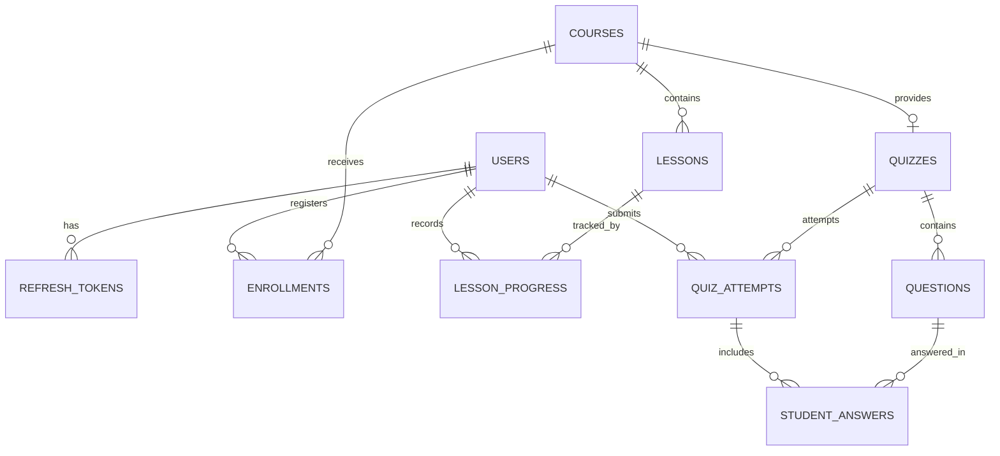

# Database Architecture & Aiven MySQL Guide

## 1. Architecture Overview

The **AI-Powered Personalized Online Learning Portal** utilizes a relational MySQL 8+ database schema. Schema evolution is version-controlled via **Flyway migrations** located in `backend/src/main/resources/db/migration/`.

### Entity-Relationship Model



---

## 2. Flyway Migration Version History

| Version | Migration Script | Description |
|---|---|---|
| **V1** | `V1__create_users.sql` | `users` table (BCrypt password, role, learning interests) and `refresh_tokens` table. |
| **V2** | `V2__create_courses_and_lessons.sql` | `courses` (category, difficulty, duration) and `lessons` (order, content, video URL). |
| **V3** | `V3__create_enrollments_and_progress.sql` | `enrollments` (completed status, timestamp) and `lesson_progress` (unique student-lesson pairing). |
| **V4** | `V4__create_quizzes_and_attempts.sql` | `quizzes`, `questions` (JSON options, correct answer index, explanation), `quiz_attempts`, and `student_answers`. |
| **V5** | `V5__add_indexes_and_constraints.sql` | Performance indexes on category, student enrollment pairs, and quiz scores. |

---

## 3. Provisioning MySQL on Aiven Cloud

### Step 1: Create an Aiven Account
1. Visit [Aiven Console](https://console.aiven.io/) and sign up / log in.
2. Click **Create Service** and select **MySQL**.
3. Select your cloud provider and region closest to your backend hosting region (e.g., AWS / Google Cloud `us-east` or `eu-central`).
4. Select the **Free Tier** or **Startup Plan** and name the service (e.g., `edupulse-mysql`).

### Step 2: Retrieve Credentials
Once the service state is **Running**, find the **Connection Information** card on the Overview tab:
* **Host**: `mysql-<unique-id>.aivencloud.com`
* **Port**: `10000-30000` (e.g. `12345`)
* **User**: `avnadmin`
* **Password**: Click to reveal password.
* **Database**: `defaultdb`

### Step 3: Configure Spring Boot Connection
Set the following environment variables in your deployment environment (e.g., on Render):

```env
SPRING_DATASOURCE_URL=jdbc:mysql://<HOST>:<PORT>/defaultdb?useSSL=true&requireSSL=true&serverTimezone=UTC&allowPublicKeyRetrieval=true
SPRING_DATASOURCE_USERNAME=avnadmin
SPRING_DATASOURCE_PASSWORD=<AIVEN_PASSWORD>
SPRING_DATASOURCE_DRIVER_CLASS_NAME=com.mysql.cj.jdbc.Driver
SPRING_JPA_DATABASE_PLATFORM=org.hibernate.dialect.MySQLDialect
SPRING_FLYWAY_ENABLED=true
```

---

## 4. Key Performance Indexes

* `idx_users_email`: B-tree index for O(1) user lookups during authentication.
* `idx_enrollment_student_course`: Unique composite index `(student_id, course_id)` preventing duplicate enrollments and accelerating dashboard queries.
* `idx_progress_student_lesson`: Unique composite index `(student_id, lesson_id)` optimizing lesson completion checks.
* `idx_attempts_quiz_student`: Composite index `(quiz_id, student_id)` accelerating student attempt history and average score calculations.
* `idx_courses_category_pub`: Composite index `(category, published)` speeding up catalog filtering and rule-based recommendation queries.
