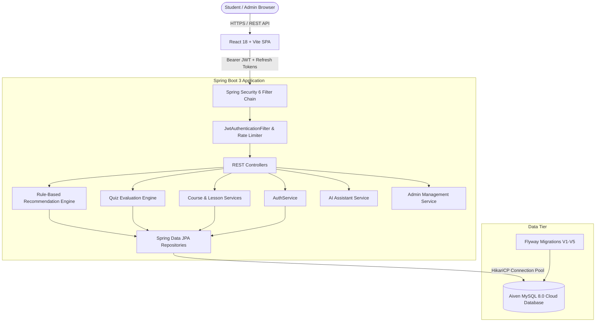

# System Architecture & Technical Design

## 1. Executive Summary

The **AI-Powered Personalized Online Learning Portal (EduPulse AI)** is an enterprise full-stack web platform built for personalized education. The system features:
* **Stateless RESTful Backend**: Built with Java 21 and Spring Boot 3.3.4, secured using JWT access/refresh token rotation and Spring Security 6.
* **Neumorphic Responsive Frontend**: Built with React 18, Vite, TypeScript, Lucide React, and Recharts, designed according to tactile Neumorphic design physics (`#E9EDF2`).
* **Relational Database**: Managed via Flyway migrations on MySQL 8 / Aiven Cloud.
* **Intelligent Recommendation Engine**: Rule-based algorithm generating scored course suggestions with transparent, human-readable rationales.
* **AI Learning Assistant**: Context-aware tutoring module offering conceptual breakdowns, practice problems, and study roadmaps.

---

## 2. High-Level Architecture Diagram

---

## 3. Backend Architecture

### 3.1 Security & Authentication Architecture
* **Dual-Token Pattern**:
  * **Access Token**: Short-lived (e.g. 15 minutes) signed with HMAC-SHA256 (`jjwt-api 0.12.6`). Passed in the `Authorization: Bearer <token>` header. Contains user ID, email, and authority roles.
  * **Refresh Token**: Long-lived (e.g. 7 days), securely stored in the MySQL database with expiration date and revocation status. Automatically refreshed by the frontend Axios interceptor on HTTP 401.
* **Rate Limiting**: Custom token-bucket rate limiter (`RateLimitService`) protecting authentication endpoints (`/api/auth/**`) against brute-force attacks.
* **Password Hashing**: BCrypt with strength factor 12.

### 3.2 Server-Side Quiz Grading Engine
Security principle: **Quiz answers are strictly hidden from the client**.
1. When a student requests a quiz (`GET /api/quizzes/{id}`), questions and answer choices are returned, but `correctAnswerIndex` and explanations are omitted.
2. Upon quiz completion, the student posts an array of `{ questionId, selectedOptionIndex }` to `POST /api/quizzes/{id}/submit`.
3. The server computes the score, records a `QuizAttempt` and individual `StudentAnswer` records in the database, checks if `score >= passingScore`, and returns the full breakdown (including correct answer indices and explanations).

### 3.3 Rule-Based Adaptive Recommendation Engine
The `RuleBasedRecommendationEngine` produces personalized course recommendations without black-box opacity. Each recommendation includes:
* **Interest Match Score (+40 points)**: Lexical match between the student's registered `learningInterests` and the course title, description, or category.
* **Category Affinity Score (+30 points)**: Evaluates past enrollments and awards points to courses in categories where the student has actively learned.
* **Prerequisite / Difficulty Progression (+15 points)**: Matches course difficulty level with student's current proficiency.
* **Quiz Mastery Score (+15 points)**: Scores boosted for courses whose related quizzes showed areas where the student scored between 50% and 80% (reinforcement learning).
* **Enrolled Exclusion**: Courses in which the student is already enrolled are automatically excluded.
* **Explainability String**: Every recommendation returns an explicit sentence describing *why* it was recommended (e.g. *"Recommended because you completed courses in Web Development and your learning interests include React"*).

---

## 4. Frontend Architecture

### 4.1 Neumorphic Design System
The user interface follows soft tactile physics:
* **Base Surface**: Light gray `#E9EDF2` with subtle cool tint.
* **Dual Shadows**:
  * Raised: `6px 6px 14px rgba(163, 177, 198, 0.6), -6px -6px 14px rgba(255, 255, 255, 0.8)`
  * Inset (Pressed/Input): `inset 3px 3px 6px rgba(163, 177, 198, 0.6), inset -3px -3px 6px rgba(255, 255, 255, 0.8)`
* **High Contrast Typography**: Charcoal `#1E293B` ensuring WCAG 2.1 AA accessibility compliance.
* **Accent Colors**: Electric Indigo (`#5B67F1`), Emerald (`#10B981`), Amber (`#F59E0B`), Coral (`#EF4444`).

### 4.2 State & Session Management
* **AuthContext**: Centralized React context managing user authentication state, token persistence in `localStorage`, and role verification.
* **Axios Interceptor**:
  * Injects `Authorization: Bearer <token>` into outgoing requests.
  * Intercepts `401 Unauthorized` responses and buffers concurrent requests while dispatching a single `/api/auth/refresh` request.
  * Logs the user out and redirects to `/login` if refresh token is invalid or expired.
