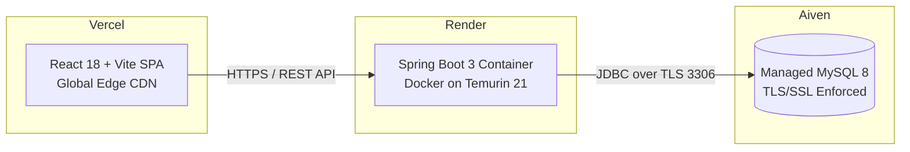

# Production Cloud Deployment Guide

This guide details the complete production deployment process for the **AI-Powered Personalized Online Learning Portal (EduPulse AI)** across **Aiven (Database)**, **Render (Backend)**, and **Vercel (Frontend)**.



---

## 1. Database Tier: Aiven Managed MySQL

1. Sign in to the [Aiven Console](https://console.aiven.io/).
2. Click **Create Service**, select **MySQL**, choose your cloud provider and region (e.g. AWS `us-east-1`).
3. Select the **Free Tier** or **Startup Plan** and name the service `edupulse-mysql`.
4. Wait for status to show **Running**, then extract connection details from the **Overview** tab:
   * **Host**: `mysql-XXXX.aivencloud.com`
   * **Port**: `XXXXX`
   * **Database**: `defaultdb`
   * **User**: `avnadmin`
   * **Password**: `****************`
5. Formulate your JDBC URL:
   ```text
   jdbc:mysql://<HOST>:<PORT>/defaultdb?useSSL=true&requireSSL=true&serverTimezone=UTC&allowPublicKeyRetrieval=true
   ```

---

## 2. Backend Tier: Render Web Service (Docker)

1. Sign in to [Render Dashboard](https://dashboard.render.com/).
2. Click **New +** -> **Web Service**.
3. Connect your GitHub repository containing this project.
4. Configure service settings:
   * **Name**: `edupulse-api` (or similar)
   * **Region**: Same geographical region as your Aiven MySQL instance.
   * **Branch**: `main`
   * **Root Directory**: `backend`
   * **Runtime**: **Docker**
   * **Dockerfile Path**: `Dockerfile`
   * **Instance Type**: **Free** or **Starter**
5. Configure Environment Variables in Render:
   | Key | Value | Description |
   |---|---|---|
   | `SPRING_DATASOURCE_URL` | `jdbc:mysql://<HOST>:<PORT>/defaultdb?useSSL=true&requireSSL=true&serverTimezone=UTC&allowPublicKeyRetrieval=true` | Aiven JDBC URL |
   | `SPRING_DATASOURCE_USERNAME` | `avnadmin` | Aiven username |
   | `SPRING_DATASOURCE_PASSWORD` | `<AIVEN_PASSWORD>` | Aiven secret password |
   | `APP_JWT_SECRET` | `5e884898da28047151d0e56f8dc6292773603d0d6aabbdd62a11ef721d1542d8` | 64+ char secret key |
   | `APP_CORS_ALLOWED_ORIGINS` | `https://edupulse-ai.vercel.app,http://localhost:5173` | Your Vercel frontend URL |
   | `SPRING_FLYWAY_ENABLED` | `true` | Runs automated migrations V1-V5 |
   | `SPRING_PROFILES_ACTIVE` | `prod` | Production Spring profile |
6. Health Check Path:
   * Set **Health Check Path** to `/actuator/health`.
7. Click **Create Web Service**.
   * Render will build the multi-stage Docker image using Java 21, run Flyway migrations, and bind to Render's dynamic `$PORT`.
   * Note your backend URL: `https://edupulse-api.onrender.com`.

---

## 3. Frontend Tier: Vercel

1. Sign in to [Vercel Dashboard](https://vercel.com/).
2. Click **Add New...** -> **Project**.
3. Import the GitHub repository.
4. Configure Project Settings:
   * **Framework Preset**: `Vite`
   * **Root Directory**: Click Edit and select `frontend`.
   * **Build Command**: `npm run build`
   * **Output Directory**: `dist`
   * **Install Command**: `npm install`
5. Configure Environment Variables:
   | Key | Value |
   |---|---|
   | `VITE_API_BASE_URL` | `https://edupulse-api.onrender.com/api` |
6. Single Page Application Routing Verification:
   * Ensure `frontend/vercel.json` contains:
     ```json
     {
       "rewrites": [
         {
           "source": "/(.*)",
           "destination": "/index.html"
         }
       ]
     }
     ```
7. Click **Deploy**.
   * Vercel builds the bundle and serves it across edge locations with TLS.
8. Update `APP_CORS_ALLOWED_ORIGINS` on Render if your assigned Vercel URL differs from the placeholder.

---

## 4. Post-Deployment Verification

1. **Backend Health Check**:
   ```bash
   curl -i https://edupulse-api.onrender.com/actuator/health
   # Expected: {"status":"UP"}
   ```
2. **OpenAPI / Swagger UI**:
   Navigate to `https://edupulse-api.onrender.com/swagger-ui.html`.
3. **Frontend Verification**:
   Navigate to your Vercel deployment URL:
   * Sign in with demo student: `student@portal.com` / `Student123!`
   * Enroll in a course, take a quiz, inspect recommendations.
   * Sign in with demo admin: `admin@portal.com` / `Admin123!`
   * View live statistics and manage content.
